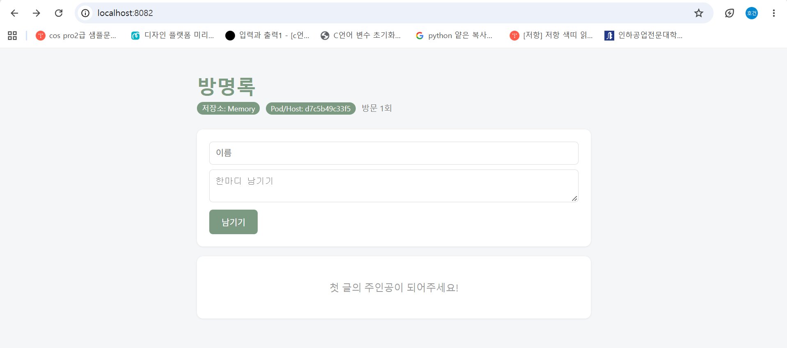
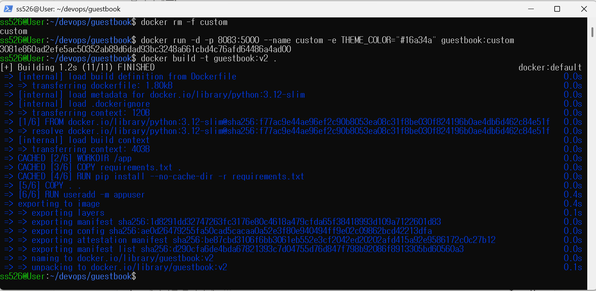
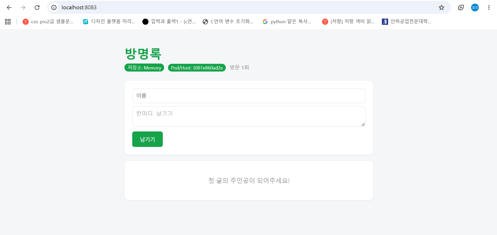
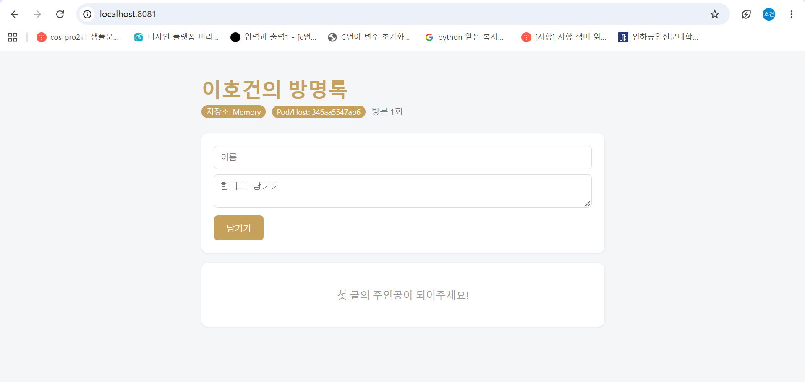

# Week 06 - Dockerfile & ghcr.io 배포

## 1. 내 이미지 주소
- ghcr.io/leehogun/guestbook:v2

## 2. 친구 이미지를 실행한 결과
- 친구 이미지: `ghcr.io/kimmyeongsuk/guestbook:v1`
- 처음에 `inhatc-devops-guestbook`이라는 이름으로 pull했더니 `denied`가 나왔고, 친구가 올린 실제 이름 `guestbook`으로 받아서 성공했다. 없는 이미지도 ghcr.io는 `denied`로 응답했다.
- 내 컴퓨터에는 친구의 소스 코드도, Flask도, 파이썬 버전 맞춤도 없었지만 이미지만 받아서 바로 실행됐다.
- 친구 이미지를 `FROM`으로 받아 환경 변수만 얹은 `Dockerfile.custom`으로 `guestbook:custom`을 빌드했다.

```dockerfile
FROM ghcr.io/kimmyeongsuk/guestbook:v1
ENV APP_TITLE="방명록" \
    THEME_COLOR="#7C9A82"
```



## 3. Dockerfile 각 줄 설명
| 명령어 | 하는 일 |
|---|---|
| FROM python:3.12-slim | 파이썬 3.12가 들어 있는 가벼운 이미지를 기반으로 시작한다 |
| WORKDIR /app | 컨테이너 안의 작업 폴더를 /app으로 정한다. 없으면 만든다 |
| COPY requirements.txt . | 라이브러리 목록 파일만 먼저 이미지 안으로 복사한다 |
| RUN pip install --no-cache-dir -r requirements.txt | 빌드할 때 Flask 등을 설치한다. 결과가 이미지에 남고 pip 캐시는 저장하지 않아 크기를 줄인다 |
| COPY . . | 나머지 소스 코드(app.py, templates 등)를 복사한다 |
| RUN useradd -m appuser / USER appuser | root가 아닌 일반 사용자를 만들어 그 사용자로 실행한다 (보안) |
| ENV APP_TITLE, THEME_COLOR | 제목과 색 기본값을 이미지에 구워 둔다. 실행 때 `-e`로 덮어쓸 수 있다 |
| EXPOSE 5000 | 이 앱이 5000번 포트를 쓴다는 메모일 뿐이고, 실제로 열려면 `-p`가 필요하다 |
| CMD ["python", "app.py"] | 컨테이너가 시작될 때마다 앱을 실행한다 (RUN은 빌드 때 한 번, CMD는 실행 때마다) |

## 4. 빌드 캐시 (CACHED)
- 다시 빌드했을 때 `WORKDIR`, `COPY requirements.txt`, `RUN pip install` 단계는 `CACHED`로 바로 지나갔다.
- `COPY . .`와 그 뒤 단계는 다시 실행됐는데, 폴더의 파일이 바뀌면(예: `Dockerfile.custom` 추가) 그 지점부터 캐시가 무효화되기 때문이다.
- requirements.txt를 먼저 복사하는 이유: 코드는 자주 바뀌고 라이브러리 목록은 덜 바뀐다. 코드를 뒤에 두면 코드만 고쳐도 `pip install`은 캐시를 써서 재빌드가 빨라진다.



## 5. 설정을 넣는 세 가지 방법
| 방법 | 언제 확정 | 바꾸려면 |
|---|---|---|
| app.py 기본값 수정 | 코드 | 코드 수정 후 재빌드 |
| Dockerfile의 ENV | 이미지 빌드 시점 | 재빌드 |
| docker run -e | 컨테이너 실행 시점 | 컨테이너만 다시 실행 |

- 우선순위: 코드 기본값 < Dockerfile ENV < docker run -e
- 확인한 결과: `guestbook:custom`에는 `THEME_COLOR="#7C9A82"`(연한 초록)가 구워져 있는데, `docker run -e THEME_COLOR="#16a34a"`로 실행하니 화면이 선명한 초록(#16a34a)으로 나왔다. 제목은 `-e`를 주지 않았기 때문에 구운 값 "방명록"이 그대로였다.

```bash
docker run -d -p 8083:5000 --name custom -e THEME_COLOR="#16a34a" guestbook:custom
```



## 6. 나만의 방명록 v2
- 커스터마이징 3곳
  - 제목: Dockerfile의 `APP_TITLE`을 "이호건의 방명록"으로 변경
  - 색: Dockerfile의 `THEME_COLOR` 변경
  - 문구: `templates/index.html`의 빈 방명록 안내를 "첫 글의 주인공이 되어주세요!"로 변경
- 구운 것과 주입한 것의 차이: Dockerfile에 구운 색은 #7C3AED인데, `-e THEME_COLOR="#C6A15B"`를 주고 실행하니 금색이 적용됐다. 이미지는 그대로이고 설정만 바깥에서 바꿨다.

```bash
docker run -d -p 8081:5000 --name gbv2 -e THEME_COLOR="#C6A15B" ghcr.io/leehogun/guestbook:v2
```


