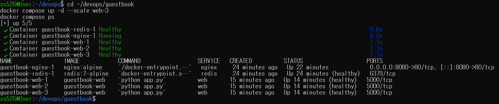
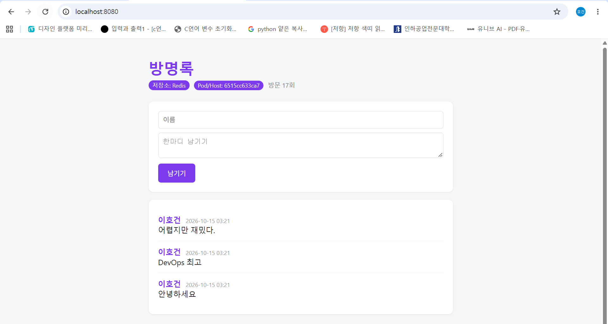
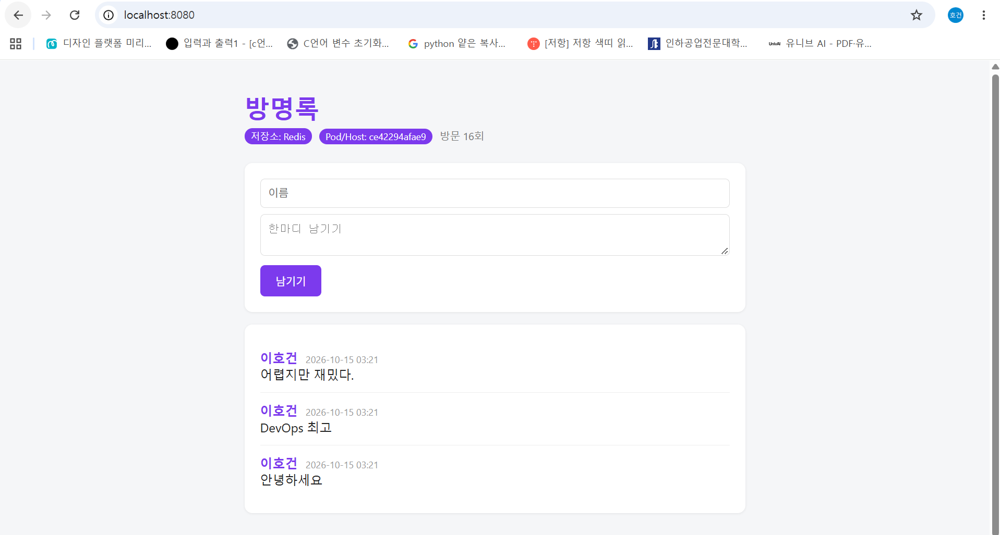
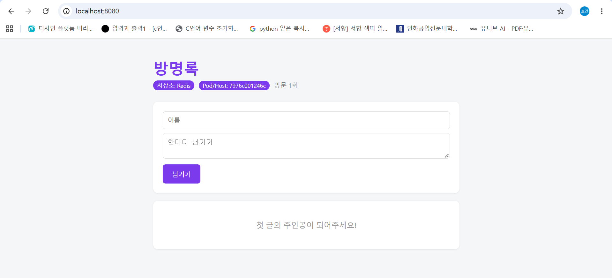

# Week07 - Docker Compose (nginx + web x3 + redis)

nginx 1개, web(Flask 방명록) 3개, redis 1개를 Docker Compose로 묶어서 실행했다.

## 1. docker compose ps 결과

```
NAME                IMAGE            COMMAND                  SERVICE   CREATED          STATUS                    PORTS
guestbook-nginx-1   nginx:alpine     "/docker-entrypoint.…"   nginx     24 minutes ago   Up 22 minutes             0.0.0.0:8080->80/tcp, [::]:8080->80/tcp
guestbook-redis-1   redis:7-alpine   "docker-entrypoint.s…"   redis     24 minutes ago   Up 24 minutes (healthy)   6379/tcp
guestbook-web-1     guestbook-web    "python app.py"          web       15 minutes ago   Up 14 minutes (healthy)   5000/tcp
guestbook-web-2     guestbook-web    "python app.py"          web       15 minutes ago   Up 14 minutes (healthy)   5000/tcp
guestbook-web-3     guestbook-web    "python app.py"          web       15 minutes ago   Up 14 minutes (healthy)   5000/tcp
```



web 3개와 redis 모두 healthy 상태다. 외부에 열린 포트는 nginx의 8080 하나뿐이고, web은 expose로 5000번을 내부에서만 쓰게 했다. nginx는 healthcheck를 안 걸어서 Up으로만 나온다.

## 2. scale 후 호스트명 변경

`docker compose up -d --scale web=3`으로 web을 3개 띄우고 localhost:8080을 새로고침해 봤다.

| 캡처 | Pod/Host | 방문 횟수 |
|---|---|---|
| scale1 | ce42294afae9 | 16회 |
| scale2 | 6515cc633ca7 | 17회 |




새로고침할 때마다 응답하는 컨테이너가 바뀐다. nginx가 Docker 내장 DNS(127.0.0.11)로 web을 조회하면 컨테이너 3개의 IP가 나오고, 그중 하나로 요청을 보내기 때문이다. 컨테이너가 바뀌어도 방문 횟수랑 글이 이어지는 건 셋이 같은 redis를 쓰고 있어서다.

## 3. down 후 up vs down -v 후 up

| 명령 | 컨테이너·네트워크 | 볼륨 | 방명록 데이터 |
|---|---|---|---|
| `docker compose down` → `up` | 삭제 후 재생성 | 유지 | 남아 있음 |
| `docker compose down -v` → `up` | 삭제 후 재생성 | 삭제 | 사라짐 |

**down → up** : 글 3개랑 방문 횟수가 그대로 남아 있다.



**down -v → up** : 글이 다 없어지고 방문 횟수도 처음부터 다시 센다.



down은 컨테이너와 네트워크만 지우고 볼륨은 남겨둔다. 그래서 다시 up하면 redis가 기존 볼륨에서 데이터를 그대로 읽어온다. -v를 붙이면 볼륨까지 지워져서 빈 상태로 새로 시작한다. 실제 서비스에서 down -v를 잘못 치면 데이터가 날아가니까 조심해야 한다.

## 4. .env를 Git에 올리지 않는 이유

.env에는 DB 비밀번호나 API 키 같은 민감한 값이 들어간다. 이걸 Git에 올리면 저장소를 볼 수 있는 사람은 다 그 값을 보게 된다. 나중에 파일을 지워도 커밋 기록에 남아 있어서 꺼내 볼 수 있기 때문에, 한 번 올라간 키는 새로 발급받는 수밖에 없다. 그리고 개발용, 운영용 등 환경마다 값이 달라서 애초에 같이 공유할 파일도 아니다.

그래서 .env는 .gitignore에 넣어 제외하고, 어떤 변수가 필요한지만 적은 .env.example을 대신 올린다. 다른 사람은 이걸 복사해서 .env를 만들고 자기 값을 넣어 쓰면 된다.
