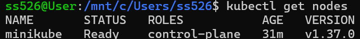
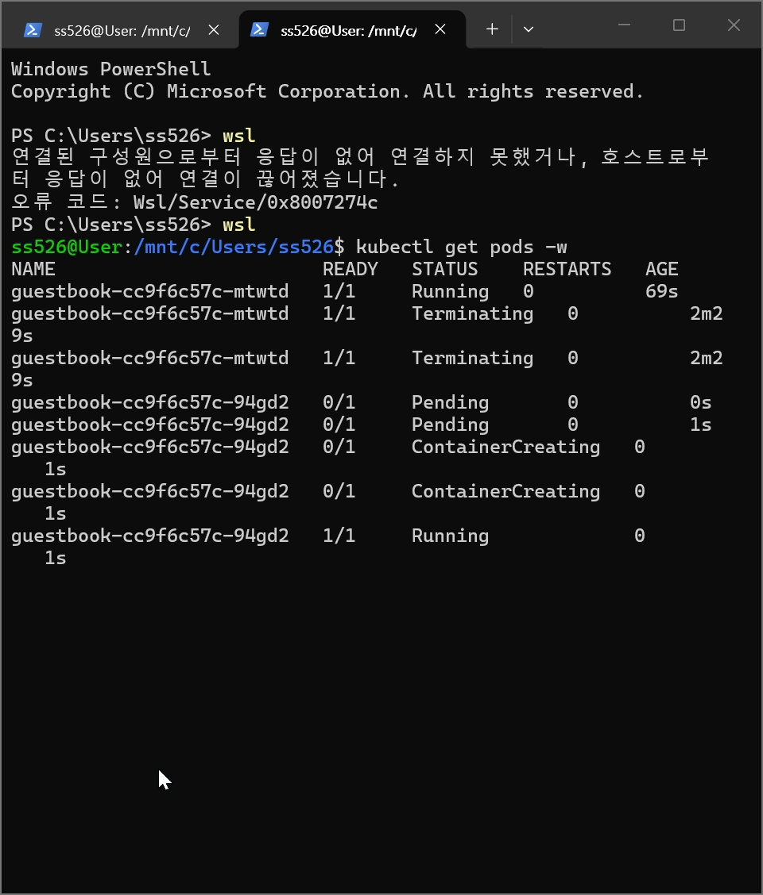
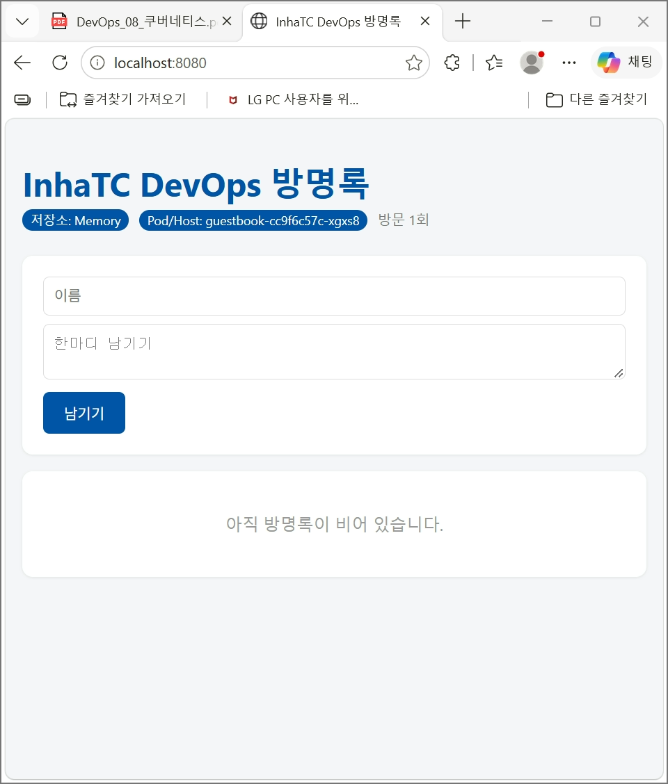

# Week09 - 쿠버네티스 첫 배포

사용 도구: **minikube** (driver=docker)

## 1. kubectl get nodes



```
NAME       STATUS   ROLES           AGE   VERSION
minikube   Ready    control-plane   31m   v1.37.0
```

## 2. 자가 치유 - Pod를 지운 뒤 새 Pod가 생성됨

`kubectl delete pod -l app=guestbook` 실행 후 `kubectl get pods -w`로 관찰



- 기존 Pod(`mtwtd`)가 Terminating 되고, 새 Pod(`94gd2`)가 Pending → ContainerCreating → Running으로 생성됨
- "살려라"라는 명령 없이 Deployment가 원하는 개수(1개)를 맞추기 위해 새로 만든 것
- 이름 끝이 다르므로 되살린 것이 아니라 새로 만든 Pod

## 3. 쿠버네티스에서 실행한 내 방명록

`kubectl create deployment guestbook --image=ghcr.io/leehogun/guestbook:v1`
`kubectl port-forward deployment/guestbook 8080:5000`



- Pod/Host 배지에 실제 Pod 이름(`guestbook-cc9f6c57c-xgxs8`)이 표시됨
- Pod를 지우면 새 Pod는 생기지만 port-forward 연결이 끊기고, 저장소가 Memory라 남긴 글도 사라짐

## 4. 선언형이란

"어떻게 하라"고 하나하나 시키는 게 아니라 "이런 상태여야 한다"고 정해두면 시스템이 알아서 맞춰주는 방식이다. 에어컨을 26도로 맞춰두면 알아서 켜지고 꺼지는 것처럼, `replicas: 3`이라고 해두면 쿠버네티스가 Pod 개수를 계속 세면서 3개를 유지한다.

## 5. 막혔던 것과 해결 방법

| 증상 | 원인 | 해결 |
|---|---|---|
| `minikube start` 실패 (`PROVIDER_DOCKER_VERSION_EXIT_1`) | Docker Desktop이 꺼져 있었음 | Docker Desktop 실행 후 다시 start |
| `kubectl exec` 에러 (`must specify at least one command`) | `--` 앞뒤 띄어쓰기 누락 | `kubectl exec -it mynginx -- bash` |
| `delete pod` 시 NotFound | 슬라이드의 Pod 이름을 그대로 입력 | `get pods`로 내 Pod 이름 확인 후 삭제 |
| 방명록 대신 nginx 화면이 뜸 | 이전 탭의 브라우저 캐시 | Ctrl+F5 강력 새로고침 |
| Pod 삭제가 30초 정도 걸리고 옛 Pod가 Error로 표시됨 | 앱이 종료 신호에 바로 반응하지 않아 대기 시간 후 강제 종료됨 | 정상 동작, 새 Pod는 Running 유지 |
