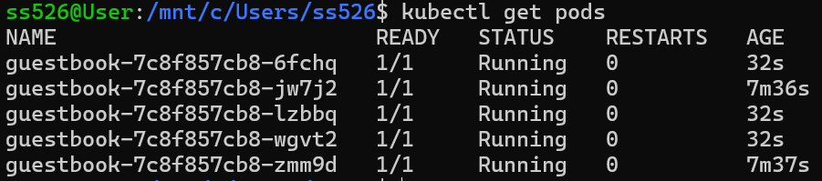
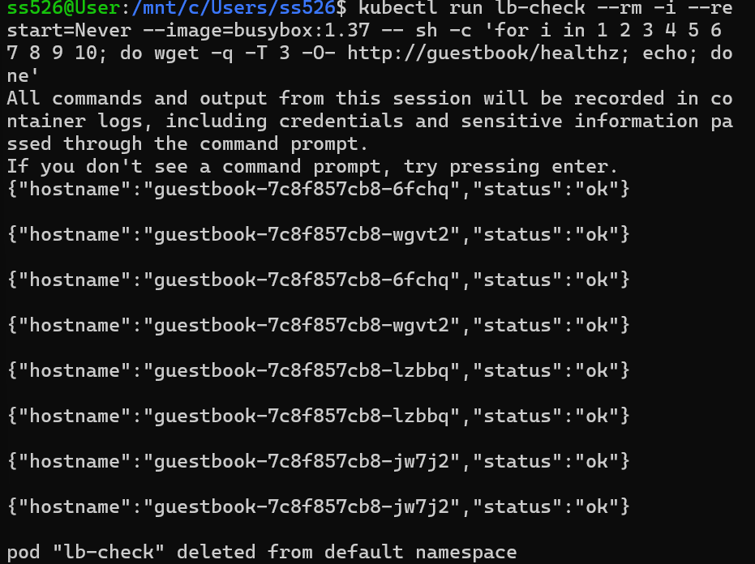
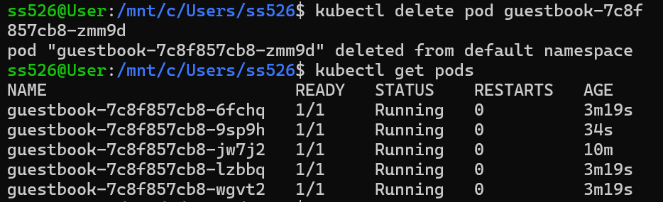
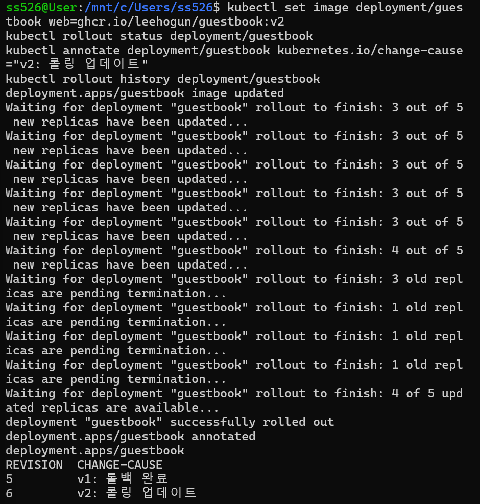
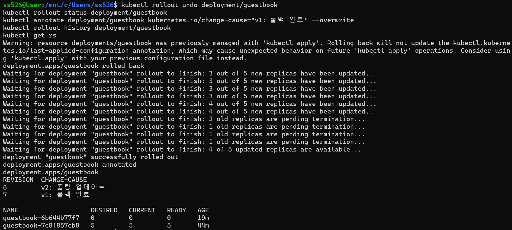

# Week10 - 쿠버네티스 Deployment와 Service

## 1. replicas 5로 스케일링
`kubectl scale deployment guestbook --replicas=5` 실행 후 Pod 5개가 모두 Running 상태가 됨

## 2. 서비스를 통과한 요청의 Pod hostname
busybox Pod에서 `http://guestbook/healthz`로 10번 요청을 보낸 결과, 서비스가 selector(`app=guestbook`)로 찾은 Pod들에게 요청을 나눠 보내서 서로 다른 hostname이 응답함

- guestbook-7c8f857cb8-6fchq
- guestbook-7c8f857cb8-wgvt2
- guestbook-7c8f857cb8-lzbbq
- guestbook-7c8f857cb8-jw7j2

## 3. 자가 치유
Pod `guestbook-7c8f857cb8-zmm9d`를 삭제하자 ReplicaSet이 개수(5개)를 맞추기 위해 새 Pod `guestbook-7c8f857cb8-9sp9h`를 자동으로 생성함

## 4. v1 → v2 롤링 업데이트
`kubectl set image`로 v2 이미지로 변경. 새 ReplicaSet이 생기고, 새 Pod를 띄운 뒤 옛 Pod를 하나씩 종료하는 방식으로 교체되어 서비스가 멈추지 않음. `kubectl annotate`로 변경 이유를 기록함

## 5. 롤백
`kubectl rollout undo`로 이전 ReplicaSet(v1, `7c8f857cb8`)을 다시 5개로 살리고, v2 ReplicaSet(`6b644b77f7`)은 0개로 남겨둠. 코드를 되돌리거나 다시 빌드할 필요 없이 롤백됨

