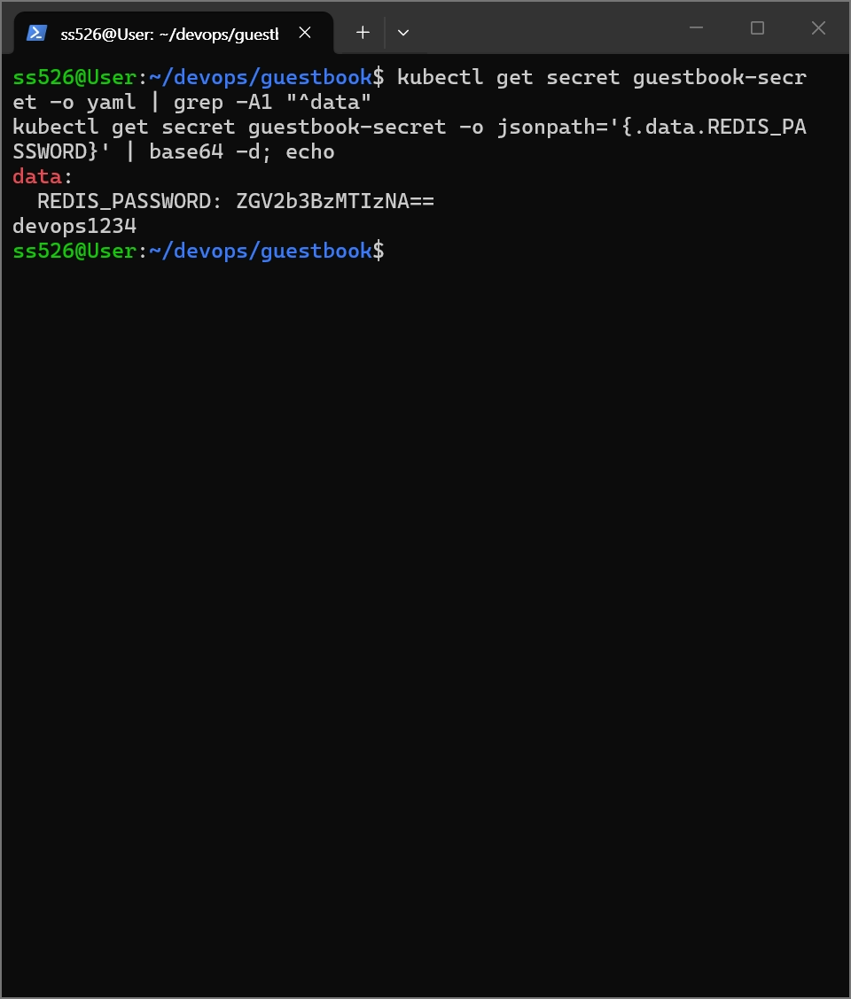
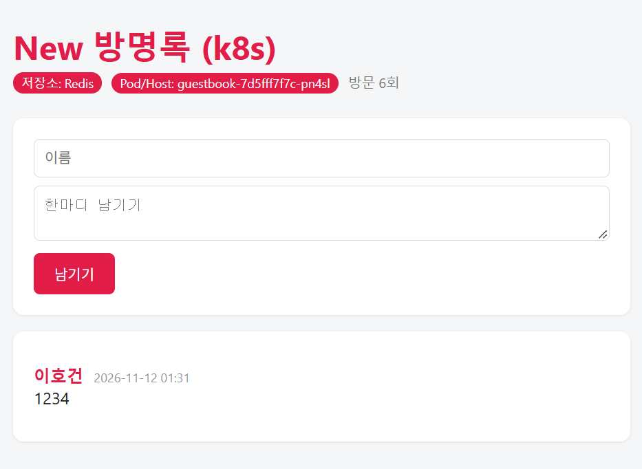
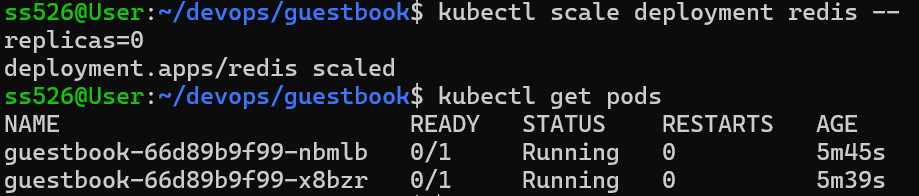
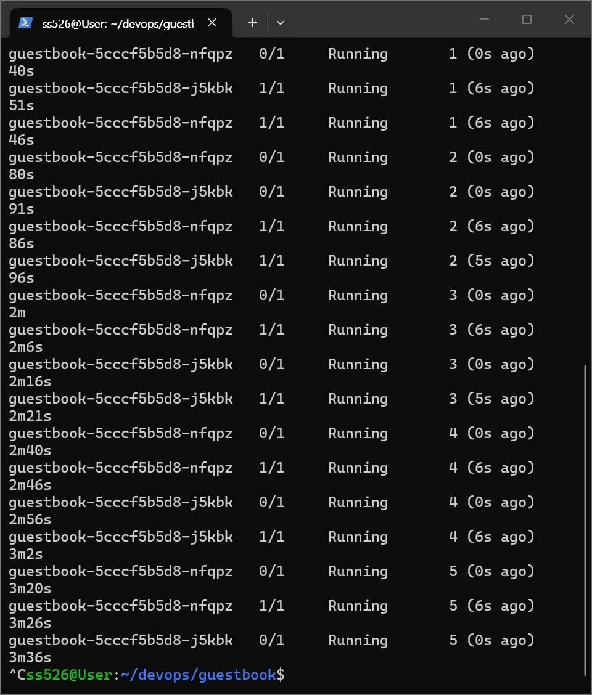
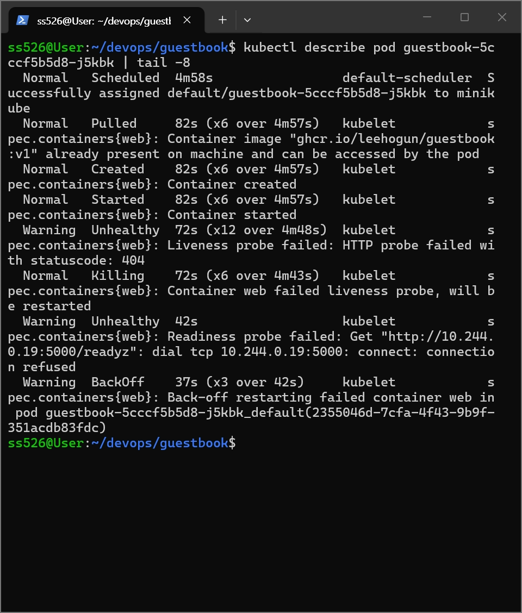

# Week 11 - 쿠버네티스 설정과 상태 점검

## 1. Secret은 안전한가?

- Secret의 `data`에 들어 있는 `ZGV2b3BzMTIzNA==`는 암호화가 아니라 base64 **인코딩**이다.
- 열쇠 없이 `base64 -d` 한 번이면 원래 비밀번호 `devops1234`가 그대로 나온다.
- 그래서 Secret도 Git에 올리면 안 된다. `secret.yaml`은 `.gitignore`에 넣고, 저장소에는 비밀번호를 `CHANGE_ME`로 바꾼 `secret.yaml.example`만 올렸다.

## 2. ConfigMap만 바꿔서 설정 변경

- `kubectl edit configmap`으로 `APP_TITLE`을 "New 방명록 (k8s)", `THEME_COLOR`를 `#e11d48`로 바꾸고 `rollout restart`를 했다.
- 이미지를 다시 빌드하지 않았고 코드도 고치지 않았는데 제목과 색이 바뀌었다.
- Pod 이름이 바뀌었는데도 전에 남긴 글이 그대로 있다. 데이터가 Pod가 아니라 Redis에 있기 때문이다(무상태 + 공유 DB).
- 환경 변수는 컨테이너가 시작될 때 정해지기 때문에, ConfigMap을 고친 뒤에는 restart를 해야 반영된다.

## 3. readiness 실패 (READY 0/1)

- Redis를 `--replicas=0`으로 끄자 `/readyz`가 503을 돌려줬고, guestbook Pod가 `Running`인데 `READY 0/1`이 됐다.
- RESTARTS는 0 그대로다. readiness가 실패하면 재시작하지 않고 서비스에서 트래픽만 끊는다.
- Redis를 다시 켜자 자동으로 `1/1`로 돌아왔다.

## 4. liveness 실패 (RESTARTS 증가)

- `kubectl patch`로 liveness 경로를 없는 주소인 `/devops`로 바꿨다.
- 앱은 멀쩡한데 probe가 404를 받아서 RESTARTS가 1, 2, 3, 4, 5로 계속 올랐다.
- Events에서 `Liveness probe failed: ... statuscode: 404`를 확인했다. 실패 12번에 재시작 6번으로, `failureThreshold: 2`대로 동작했다.
- probe 경로를 잘못 쓰면 정상인 앱도 계속 재시작된다. `kubectl apply -f`로 원래 설정으로 되돌렸다.

## 5. 트러블슈팅 3단 루틴

1. **get** - `kubectl get pods`로 STATUS, READY, RESTARTS를 보고 어디가 이상한지 먼저 찾는다.
2. **describe** - `kubectl describe pod <이름>`의 맨 아래 Events를 본다. 오늘 liveness 실험에서도 원인(404)이 여기에 그대로 나와 있었다.
3. **logs** - Events만으로 모르겠으면 `kubectl logs <이름>`으로 앱의 에러 메시지를 본다. 계속 재시작 중이면 `--previous`로 죽기 전 로그를 본다.

오늘 실습하면서 YAML 들여쓰기 실수로 `readinessProbe`가 `livenessProbe` 안에 들어갔을 때, apply 에러 메시지의 `livenessProbe.readinessProbe`를 보고 위치가 틀렸다는 걸 찾았다. 에러 메시지를 끝까지 읽으면 대부분 어디가 문제인지 나와 있다.
