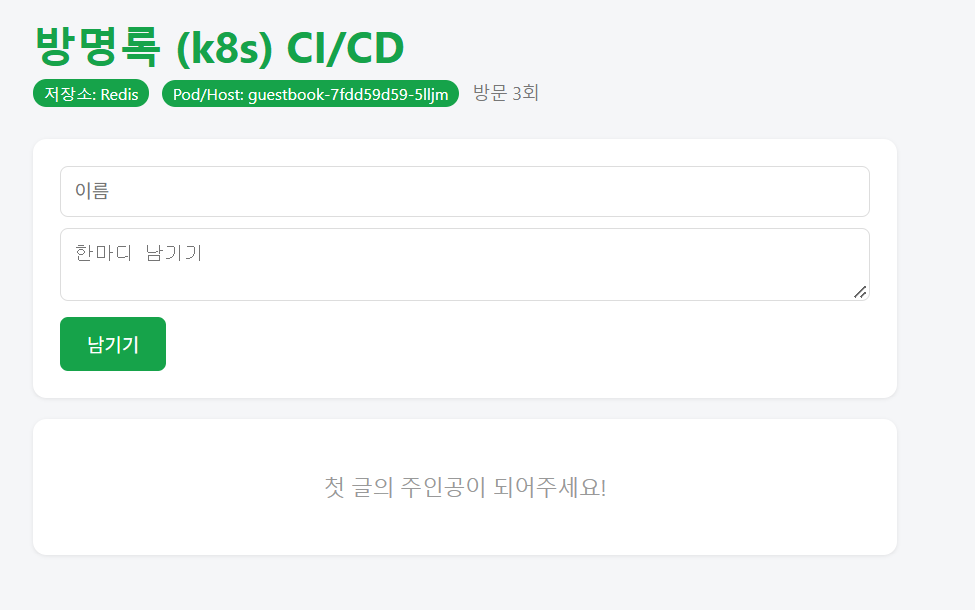
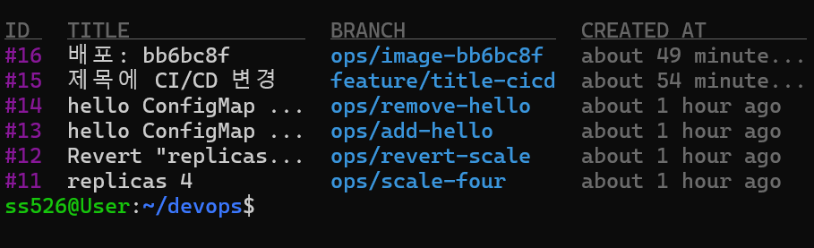
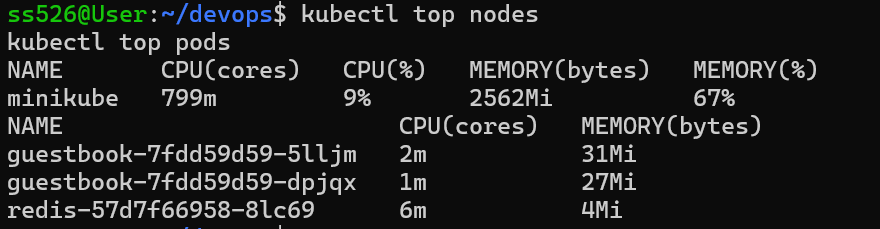

# 13주차: 깃옵스 (GitOps) - Argo CD로 CD 구축

## 1. 실습 목표
- Argo CD를 설치하고 Git 저장소(`guestbook/k8s`)와 클러스터를 동기화
- `kubectl`을 직접 쓰지 않고 **PR 머지만으로** 배포·확장·롤백·삭제가 되는 것을 확인
- 12주차 CI(GHCR 이미지 게시)와 연결해 코드 수정 → 이미지 태그 PR → 자동 배포 흐름 완성
- `kubectl top`, Prometheus·Grafana로 CPU/메모리 지표 확인

## 2. 진행 내용

### Argo CD 설치 및 애플리케이션 등록
- `argocd` 네임스페이스에 Argo CD(stable) 설치 후 Pod가 Running이 될 때까지 대기
- `argocd-application.yaml` 작성 → `kubectl apply`로 등록
  - `repoURL`: `https://github.com/LeeHoGun/devops.git`, `targetRevision: main`, `path: guestbook/k8s`
  - `destination.server`: `https://kubernetes.default.svc`, `namespace: default`
  - `syncPolicy.automated`: `prune: true`, `selfHeal: true`
- Argo CD 화면에서 guestbook 앱이 **Synced / Healthy**인 것 확인
- `ops/argocd-app` 브랜치 → PR(#10)로 저장소에 기록

### 실습 1. Git 변경하기 (replicas 2 → 4)
- `ops/scale-four` 브랜치에서 `deployment.yaml`의 `replicas`를 4로 수정 → PR(#11) 머지
- kubectl 없이 약 3분 뒤 guestbook Pod가 4개로 늘어난 것 확인

### 실습 2. 손으로 변경 (selfHeal)
- `kubectl scale deployment guestbook --replicas=10`으로 직접 바꿈
- 잠시 후 Argo CD가 Git에 적힌 4개로 되돌림 → **Git에 없는 변경은 인정되지 않음**

### 실습 3. 롤백 (git revert)
- `ops/revert-scale` 브랜치에서 `git revert "$SCALE_COMMIT"` → PR(#12) 머지
- Argo CD가 변경을 감지해 replicas 2로 복구

### 실습 4. prune
- `ops/add-hello`: `guestbook/k8s/hello.yaml`(ConfigMap) 추가 → PR(#13) 머지 → `kubectl get cm hello` 생성 확인
- `ops/remove-hello`: `git rm`으로 hello.yaml 삭제 → PR(#14) 머지 → 클러스터에서도 hello가 삭제됨 (`NotFound`)

### 실습 5. 이미지 배포 (CI → CD 연결)
- `feature/title-cicd`: `templates/index.html` 제목을 `CI/CD`로 수정 → PR 머지
- main에서 Actions(Build and Push Image)가 ✓ 될 때까지 대기 → GHCR에 `ghcr.io/leehogun/guestbook:bb6bc8f` 게시
- `ops/image-bb6bc8f`: `deployment.yaml`의 `image:`를 `...guestbook:bb6bc8f`로 변경 → PR(#16) 머지
- 새 Pod가 하나씩 뜨고 옛 Pod가 하나씩 내려가는 **롤링 업데이트** 확인 → 브라우저에서 제목이 `CI/CD`로 바뀐 것 확인
- 이번 실습에서 사람이 한 일: **코드 수정 PR, 태그 수정 PR 머지**뿐 (kubectl로 배포하지 않음)

- 제목이 `방명록 (k8s) CI/CD`로 바뀌었고, Pod 이름(`guestbook-7fdd59d59-...`)이 새 이미지로 뜬 Pod로 바뀐 것 확인

- #11~#16 모두 PR 머지만으로 클러스터에 반영됨 (확장 → 롤백 → ConfigMap 추가/삭제 → 코드 수정 → 이미지 태그 변경)

### 정리
- `kubectl delete -f argocd-application.yaml`로 애플리케이션 등록 해제 (GitOps 관리 중단, 기존 리소스는 유지)

### 모니터링
- `minikube addons enable metrics-server` → `kubectl top nodes`, `kubectl top pods`로 CPU/메모리 확인

- 노드: CPU 9%, 메모리 67% 사용 / guestbook Pod는 CPU 1~2m, 메모리 27~31Mi로 가볍게 동작
- Helm으로 `kube-prometheus-stack` 설치(`monitoring` 네임스페이스) → Grafana 포트포워딩 후 대시보드 확인
- `kubectl logs -l app=guestbook --tail=20` 등으로 라벨 기반 로그 확인

## 3. 트러블슈팅

| 증상 | 원인 | 해결 |
|---|---|---|
| Argo CD 앱 상태가 계속 `Unknown` | `destination.server`를 `kubernetes.defualt.svc`로 오타 | `default`로 수정 후 다시 apply → Refresh |
| `gh pr merge` 시 `the base branch policy prohibits the merge` | 브랜치 보호 규칙 때문에 CI 검사가 끝나기 전에는 머지 불가 | `gh pr checks --watch`로 ✓ 확인 후 머지 |
| `git add guestbook/k8s/deployment.yaml`이 `pathspec did not match` | 이미 `guestbook/k8s` 폴더 안에서 실행해 경로가 중복됨 | 저장소 최상위(`~/devops`)로 이동 후 실행 |
| `git pr create` → `not a git command` | `gh` 명령을 `git`으로 입력 | `gh pr create --fill` |
| hello 삭제 PR이 머지되지 않음 | PDF에서 복사하며 띄어쓰기가 빠져 `ghpr`로 입력됨 | `gh pr`로 다시 입력, PR 번호로 머지 |
| `gh pr checks --watch` → `no pull requests found for branch "main"` | 머지 후 main 브랜치에서 실행 | 머지 후에는 `gh run list --limit 1`로 확인 |
| `kubectl top nodes` → `Metrics API not available` | metrics-server가 아직 `0/1` (준비 전) | `1/1`이 된 뒤 1분 정도 기다려 다시 실행 |
| Grafana Pod가 `ContainerCreating`에서 오래 멈춤 | Grafana 이미지가 커서 내려받는 데 시간이 걸림 (`describe`의 Events에서 `Pulling image` 확인) | 대기 / `minikube image pull`로 직접 받기 |
| `localhost:3000`에 Grafana 대신 방명록이 열림 | 이전 주차에 띄운 컨테이너가 3000번 포트를 사용 중 | `port-forward ... 3001:80`으로 다른 포트 사용 |

## 4. 배운 점
- GitOps는 **Git이 곧 진실**: 클러스터를 손으로 바꿔도 selfHeal로 Git에 적힌 상태로 돌아간다
- Pull 방식: 클러스터 안의 Argo CD가 Git을 지켜보다가 가져오므로, 외부 CI에 클러스터 권한을 줄 필요가 없다
- 배포·확장·롤백·삭제가 모두 PR로 남아서 **누가, 언제, 왜** 바꿨는지 기록되고 `git revert`로 되돌릴 수 있다
- 이미지를 GHCR에 푸시하는 것만으로는 배포되지 않는다. Git의 `image:` 태그가 바뀌어야 Argo CD가 배포한다
- Argo CD는 기본 약 3분마다 Git을 확인하므로, 바로 반영하려면 Refresh를 누른다
- 메트릭(`kubectl top`, Prometheus·Grafana)은 숫자로 상태를 보고, 로그는 무슨 일이 있었는지를 본다
